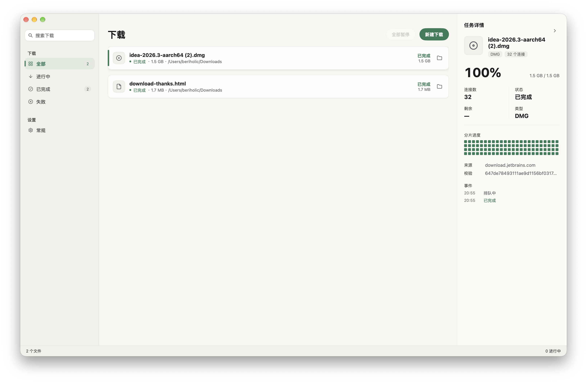

# Segra

**English** · [简体中文](README.zh-Hans.md)

Segra is a native multi-threaded segmented downloader: Go with the GPU-native UI of
[egoist/mygo](https://github.com/egoist/mygo), and no WebView anywhere. It ships with a Chromium
MV3 extension that takes over the browser's own downloads, and can also hand a link, image or
video to the desktop app from the context menu.



## Features

- **Segmented downloads** — parallel HTTP Range requests (32 connections by default, 1–64),
  planned from `Content-Range`.
- **Slow connections are replaced** — a health check borrowed from
  [Surge](https://github.com/SurgeDM/Surge): a connection that brings no new data for 3 seconds,
  or runs below 30% of the average, is dropped and opened again, so a CDN that throttles one
  connection cannot hold the whole file back. A server without Range support falls back to a
  single stream.
- **Resume** — the state of the segments is written to `.part.segra.json` and checked against the
  size, `ETag` and `Last-Modified` on the way back in. Pausing, quitting and restarting lose
  nothing.
- **Queue and concurrency** — 1–8 downloads at a time, pause all / resume all, retry failures.
- **Native UI** — drawn by mygo's `ui` package, light or dark, following the system or chosen
  in the settings, in English and Simplified Chinese, following the system or chosen by hand.
- **Browser extension** — takes over the browser's downloads: the browser's copy is cancelled and
  Segra fetches the file with the same cookies and referrer. A link, image, video or audio file
  can still be sent from the context menu, and the port and token are set in the toolbar popup.
  Ports are discovered automatically and the API wants a Bearer token.
- **Desktop integration** — single instance, menu bar tray, system notifications, close to tray,
  open at login, Dock badge.
- **Update check** — asks GitHub for a newer release at launch and once a day after that, and
  from Help → Check for Updates. It links the installer of the running platform; it does not
  replace the app behind your back. Settings → Updates turns the automatic check off.
- **Local API** — bound to `127.0.0.1`, for scripts and other clients.
- **System proxy** — through `mygo/netproxy`, following the system settings.

## Requirements

- macOS 12+ / Windows 10+ / Linux (GTK)
- Go 1.27+ (`go.mod` pins `go 1.27.3`, and `GOTOOLCHAIN=auto` fetches the toolchain)
- Pure Go, no cgo

## Development

```bash
# Optional: keep the build cache inside the repository, away from sandbox
# and permission trouble.
export GOCACHE="$PWD/.gocache"

go tool mygo dev        # development build with live reload
go test ./...           # unit tests (Range, resume, single-stream fallback)
go tool mygo vet .      # lifetime checks for the native UI
```

How the code is split into files, and which way the dependencies go, is in
[docs/architecture.md](docs/architecture.md) (Chinese).

## Building

```bash
go tool mygo build
# macOS: build/darwin-arm64/Segra.app and .dmg
# Several platforms at once:
go tool mygo build -platform darwin/universal,windows/amd64,linux/amd64

# Where hdiutil cannot write a disk image, just the .app:
go tool mygo build -skip-dmg
```

The app name, identifier, version, icon, the `segra://` URL scheme and the i18n directory are all
in `mygo.json`.

## Releasing

Pushing a tag that starts with `v` runs `.github/workflows/release.yml`: three runners build in
parallel and attach everything to one GitHub release. No secrets needed.

```bash
git tag v0.2.0
git push origin v0.2.0
```

| Platform | Artifacts |
| --- | --- |
| macOS (universal) | `segra-<version>.dmg` |
| Windows (amd64) | `segra-setup-<version>-amd64.exe` (NSIS installer) |
| Linux (amd64) | `segra_<version>_amd64.deb`, `segra-<version>-linux-amd64.tar.gz` |

The version comes from the tag: the workflow writes it into `mygo.json` before building, so the
`version` in the repository does not have to be bumped by hand. macOS is signed ad hoc and not
notarized, so a first launch there needs Open from the context menu, or
`xattr -d com.apple.quarantine /Applications/Segra.app`.

An Arch package is not published: a local `go tool mygo build -platform linux/amd64` writes a
`PKGBUILD` beside the archive, and `makepkg -si` in that directory builds and installs it.

## Installing the browser extension

The extension is packaged inside the app, so no repository and no build step is needed:

1. Open Segra's **Settings → Browser extension** and click **Export extension…** to save the zip.
2. Unzip it. Open `chrome://extensions` (Edge, Arc and Brave work the same), turn on **Developer
   mode**, click **Load unpacked** and choose the unzipped folder.
3. The exported copy carries a `config.json` with this machine's port and token, so it works as
   loaded. The toolbar popup changes both, has **Test connection**, and holds the switch that
   sends the browser's downloads to Segra.
4. From then on, any download the browser starts is cancelled there and fetched by Segra. A link
   or image can still be sent from the context menu, and Segra's own **New Download** takes a
   pasted link as before.

> When the port is taken, Segra walks up from `47823` through the next ten; the extension finds
> it there. The port can also be fixed in the settings.

To develop the extension from the repository, load `extension/` itself as the unpacked folder.
There is no `config.json` then: fill in the port and token in the popup (Settings → Extension
token → Copy token).

> Taking over downloads needs to read cookies, which is why the extension asks for `<all_urls>`:
> without the cookies, files behind a login fail to download. Segra not running means no
> interception — the download stays in the browser.

A deep link opens the New Download sheet with the link filled in:

```bash
open "segra://download?url=https%3A%2F%2Fexample.com%2Fbig.iso"
```

## Local API

Base URL: `http://127.0.0.1:47823`. Everything but `/api/health` needs
`Authorization: Bearer <apiToken>` (or `X-Segra-Token`).

| Method | Path | Purpose |
| --- | --- | --- |
| GET | `/api/health` | Liveness, no auth |
| GET | `/api/info` | Version, download directory, default connections |
| GET | `/api/tasks` | Tasks, newest first |
| POST | `/api/tasks` | Create a task |
| GET | `/api/tasks/{id}` | One task |
| DELETE | `/api/tasks/{id}?files=1` | Remove a task; `files=1` removes the file too |
| POST | `/api/tasks/{id}/pause` | Pause |
| POST | `/api/tasks/{id}/resume` | Resume or retry |
| POST | `/api/pause-all` | Pause everything |
| POST | `/api/resume-all` | Resume everything |

Creating a task:

```bash
TOKEN=$(python3 - <<'PY'
import json, os
p = os.path.expanduser("~/Library/Application Support/Segra/settings.json")
print(json.load(open(p))["apiToken"])
PY
)

curl -s http://127.0.0.1:47823/api/tasks \
  -H "Authorization: Bearer $TOKEN" \
  -H "Content-Type: application/json" \
  -d '{
    "url": "https://example.com/big.iso",
    "fileName": "big.iso",
    "dir": "/Users/me/Downloads",
    "connections": 8,
    "referer": "https://example.com/"
  }'
```

Fields: `url` (required, http/https, a missing scheme becomes `https://`), `fileName`, `dir`,
`connections` (1–64, 32 by default), `referer`, `userAgent`, `cookie`.

## Layout

```
internal/app/          app lifecycle, window, menu, tray, views, settings actions
internal/download/     task model, Range probing, segmented transfer, resume metadata, scheduler
internal/store/        JSON settings and task persistence (0600, atomic writes)
internal/server/       127.0.0.1 HTTP API with token auth
locales/               en / zh-Hans strings and the generated typed accessors
extension/             Chromium MV3 extension (service worker + settings popup), embedded at build time
resources/             app icon and menu bar icon
docs/                  architecture and motion notes
main.go                embeds the menu bar icon and starts the app
```

A download is written to `<name>.part`, then fsynced and renamed into place; a name already taken
becomes `name (2).ext`. The segment state of each task lives in `<name>.part.segra.json`.

## Notes and limitations

- HTTP(S) only, no FTP or BitTorrent. For sites that need a login, pass `cookie`, or send the
  file from the extension with its referrer.
- Resuming needs a stable `ETag` / `Last-Modified` and file size from the server; when they
  change, the download starts over.
- The token is kept in `settings.json` (mode `0600`) and in the extension's
  `chrome.storage.local`. Delete `apiToken` from `settings.json` and restart to rotate it, then
  update the extension.
- The first write to a protected folder such as `~/Downloads` makes macOS ask for Files and
  Folders access. An unsigned development binary can be refused outright by TCC; the packaged
  `.app` shows the prompt.
- The app only listens on the loopback address.

## License

[GPL-3.0](LICENSE)
