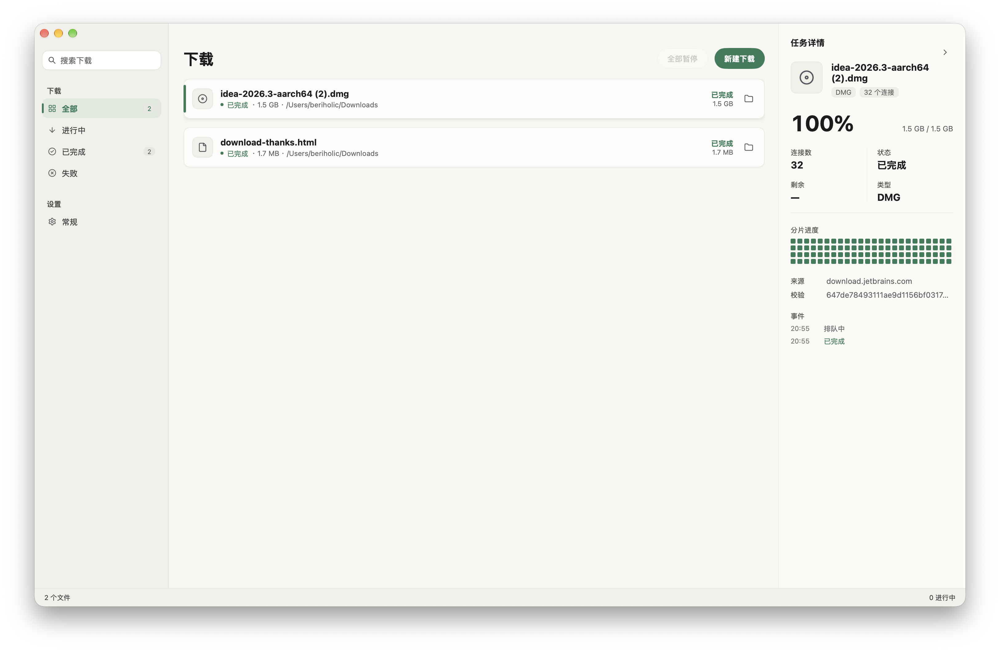

# Segra

[English](README.md) · **简体中文**

Segra 是一个原生多线程分段下载器：Go + [egoist/mygo](https://github.com/egoist/mygo) 的 GPU 原生 UI，
不依赖 WebView；附带一个 Chromium MV3 扩展，接管浏览器自己的下载，也能右键把链接、图片、视频直接交给桌面端。



## 功能

- **分段下载**：HTTP Range 并发抓取（默认 32 个连接，可调 1–64），按 `Content-Range` 规划分片；
- **慢连接自动重连**：借鉴 [Surge](https://github.com/SurgeDM/Surge) 的健康检查——某条连接 3 秒没有新数据、或速度低于平均值的 30% 时丢弃并重开，避免被 CDN 的单连接限速拖住；
  服务器不支持 Range 时自动回退单流下载。
- **断点续传**：下载中的分片状态写入 `.part.segra.json`，校验大小、ETag、Last-Modified 后续传；
  暂停、退出、重启都不会丢进度。
- **队列与并发**：同时下载数可调（1–8），全部暂停 / 全部继续，失败重试。
- **原生界面**：mygo `ui` 包直接绘制，浅色 / 深色 / 跟随系统可在设置里切换；中英双语，同样可跟随系统或手动切换。
- **浏览器扩展**：接管浏览器的下载（取消浏览器那一份，交给 Segra，带同一份 Cookie 和 referrer），
  也可以右键链接 / 图片 / 视频 / 音频手动提交；工具栏弹窗里配置端口和令牌；
  自动发现端口，Bearer Token 鉴权。
- **桌面集成**：单实例、菜单栏托盘、系统通知、关闭到托盘、开机启动、Dock 角标。
- **检查更新**：启动时以及之后每天向 GitHub 查询一次新版本，也可以从「帮助 → 检查更新」手动触发；
  给出当前平台对应的安装包链接，不会擅自替换应用。自动检查可在「设置 → 更新」中关闭。
- **本地 API**：只监听 `127.0.0.1`，方便脚本或其他客户端接入。
- **系统代理**：通过 `mygo/netproxy` 跟随系统代理设置。

## 环境要求

- macOS 12+ / Windows 10+ / Linux（GTK）
- Go 1.27+（`go.mod` 固定 `go 1.27.3`，`GOTOOLCHAIN=auto` 会自动下载工具链）
- 纯 Go，无 cgo

## 开发

```bash
# 可选：把构建缓存放进仓库，避免沙箱/权限问题
export GOCACHE="$PWD/.gocache"

go tool mygo dev        # 热重载开发
go test ./...           # 单元测试（含 Range / 续传 / 单流回退）
go tool mygo vet .      # 原生 UI 生命周期检查
```

代码怎么分文件、依赖往哪个方向走，见 [docs/architecture.md](docs/architecture.md)。

## 打包

```bash
go tool mygo build
# macOS: build/darwin-arm64/Segra.app 和 .dmg
# 也可以指定多平台：
go tool mygo build -platform darwin/universal,windows/amd64,linux/amd64

# 如果当前环境不允许 hdiutil 创建磁盘镜像，只出 .app：
go tool mygo build -skip-dmg
```

应用名、标识符、版本、图标、`segra://` URL scheme、i18n 目录都在 `mygo.json` 里配置。

## 发布

推一个 `v` 开头的 tag 就会触发 `.github/workflows/release.yml`：三个平台并行构建，
产物一起挂到同一个 GitHub Release，不需要任何 secret。

```bash
git tag v0.2.0
git push origin v0.2.0
```

| 平台 | 产物 |
| --- | --- |
| macOS（universal） | `segra-<version>.dmg` |
| Windows（amd64） | `segra-setup-<version>-amd64.exe`（NSIS 安装包） |
| Linux（amd64） | `segra_<version>_amd64.deb`、`segra-<version>-linux-amd64.tar.gz` |

版本号取自 tag：CI 先把 tag 写进 `mygo.json` 再构建，所以仓库里的 `version`
不用跟着手动改。macOS 只做 ad-hoc 签名、不做公证，别人第一次打开要在 Finder 里
右键 → 打开，或者 `xattr -d com.apple.quarantine /Applications/Segra.app`。

Arch 包不单独发布：本地 `go tool mygo build -platform linux/amd64` 会在压缩包旁边写一份
`PKGBUILD`，在那个目录里 `makepkg -si` 就能打包安装。

## 安装浏览器扩展

扩展打包在应用里，不需要仓库也不需要编译：

1. 打开 Segra 的 **设置 → 浏览器扩展**，点 **导出扩展…**，保存 zip。
2. 解压它。打开 `chrome://extensions`（Edge/Arc/Brave 同理），开启 **开发者模式**，
   点 **加载已解压的扩展程序**，选择解压出来的文件夹。
3. 导出的副本里有一份 `config.json`，带着这台机器当前的端口和令牌，装好即可用。
   点工具栏图标打开弹窗，可以改端口和令牌、点 **测试连接**，以及开关 **把浏览器下载交给 Segra**。
4. 之后浏览器里点任何下载，浏览器那一份会被取消，转由 Segra 下载；
   也可以在网页上右键链接或图片 → **使用 Segra 下载**。
   直接在 Segra 里点 **新建下载** 粘贴链接同样可以。

> 端口被占用时 Segra 会从 `47823` 开始向后找最多 10 个端口，扩展会自动发现；
> 也可以在设置里固定端口。

从仓库开发扩展时，直接把 `extension/` 目录当解压后的文件夹加载即可，
`config.json` 不存在，弹窗里手填端口和令牌（设置 → 扩展令牌 → 复制令牌）。

> 接管下载要读 Cookie，扩展因此申请了 `<all_urls>` 权限：不带上 Cookie 的话，
> 登录后才能访问的文件会下载失败。Segra 没在运行时扩展不拦截，下载照旧留在浏览器里。

也可以用 `segra://download?url=<编码后的链接>` 深链直接打开新建下载弹窗：

```bash
open "segra://download?url=https%3A%2F%2Fexample.com%2Fbig.iso"
```

## 本地 API

Base URL：`http://127.0.0.1:47823`，除 `/api/health` 外都需要
`Authorization: Bearer <apiToken>`（或 `X-Segra-Token`）。

| 方法 | 路径 | 说明 |
| --- | --- | --- |
| GET | `/api/health` | 存活检查，无需鉴权 |
| GET | `/api/info` | 版本、下载目录、默认连接数 |
| GET | `/api/tasks` | 任务列表（新→旧） |
| POST | `/api/tasks` | 新建任务 |
| GET | `/api/tasks/{id}` | 单个任务 |
| DELETE | `/api/tasks/{id}?files=1` | 删除任务，`files=1` 同时删文件 |
| POST | `/api/tasks/{id}/pause` | 暂停 |
| POST | `/api/tasks/{id}/resume` | 继续 / 重试 |
| POST | `/api/pause-all` | 全部暂停 |
| POST | `/api/resume-all` | 全部继续 |

新建任务：

```bash
TOKEN=$(python3 - <<'PY'
import json, os
p = os.path.expanduser("~/Library/Application Support/Segra/settings.json")
print(json.load(open(p))["apiToken"])
PY
)

curl -s http://127.0.0.1:47823/api/tasks \
  -H "Authorization: Bearer $TOKEN" \
  -H "Content-Type: application/json" \
  -d '{
    "url": "https://example.com/big.iso",
    "fileName": "big.iso",
    "dir": "/Users/me/Downloads",
    "connections": 8,
    "referer": "https://example.com/"
  }'
```

字段：`url`（必填，支持 http/https，缺少 scheme 时补 `https://`）、`fileName`、`dir`、
`connections`（1–64，默认 32）、`referer`、`userAgent`、`cookie`。

## 结构

```
internal/app/          应用生命周期、窗口、菜单、托盘、视图与设置动作
internal/download/     任务模型、Range 探测、分片传输、续传元数据、调度器
internal/store/        JSON 设置与任务持久化（0600、原子写）
internal/server/       127.0.0.1 HTTP API + Token 鉴权
locales/               en / zh-Hans 文案与生成的类型安全函数
extension/             Chromium MV3 扩展（service worker + 设置弹窗），编译时嵌入应用
resources/             应用图标与托盘图标
docs/                  架构与动效说明
main.go                嵌入菜单栏图标并启动应用
```

下载文件先写成 `<name>.part`，完成后 `fsync` 并原子重命名；同名文件自动变成
`name (2).ext`。每个任务的分片进度保存在 `<name>.part.segra.json`。

## 说明与限制

- 仅支持 HTTP(S)，不支持 FTP / BitTorrent；鉴权站点请通过 `cookie` 字段或扩展的 referer 提交。
- 续传依赖服务器返回稳定的 `ETag` / `Last-Modified` 和文件大小；不一致会从头开始。
- 令牌保存在 `settings.json`（权限 `0600`）和扩展的 `chrome.storage.local`；
  删除 `settings.json` 里的 `apiToken` 后重启即可轮换，再在扩展里更新。
- macOS 首次写入 `~/Downloads` 等受保护目录时，系统会请求“文件与文件夹”权限；
  未签名的开发二进制可能直接被 TCC 拒绝，打包后的 `.app` 会正常弹出授权。
- 应用只监听回环地址，不对外暴露端口。

## 许可证

[GPL-3.0](LICENSE)
